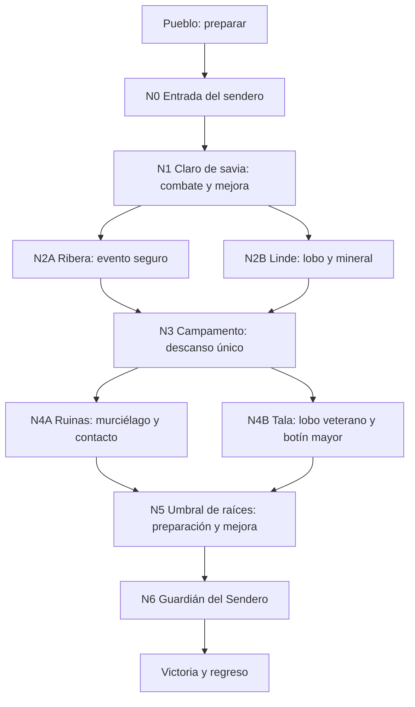

# Primera expedición — Bosque del Sendero

Fecha: 13 de noviembre de 2026. Especificación de prototipo, revisión 1. Estado: **implementada como piloto 0.3.0-dev**. La especificación conserva las reglas de alcance; ejecución y pruebas en [AVANCE-003.md](AVANCE-003.md). El balance y ritmo humanos siguen pendientes.

El usuario autorizó concretar la primera expedición después de D09/D10. Las pérdidas, clases, subclases y formato de exploración proceden de esos acuerdos. Los nombres, cantidades, encuentros y costes de este documento son decisiones operativas reversibles para el prototipo (D11), pendientes de pruebas de juego. No constituyen balance definitivo.

## 1. Qué debe demostrar

Completar pueblo → preparar personaje → recorrer escenarios → elegir mejoras → retirarse, caer o vencer → resolver mochila → reconstruir/desbloquear una opción → empezar una nueva expedición diferente.

El hito se cumple con una región rejugable. Objetivo de duración: 15–25 minutos por recorrido completo, sin cronómetro ni límite obligatorio. La duración y dificultad deben medirse jugando; el documento no las acredita.

## 2. Preparación y primeras especializaciones

La campaña piloto comienza en Refugio del Alba. Una interacción introductoria gratuita habilita el **Patio de aventureros**, edificio inicial con los tres puestos de entrenamiento básicos. Así se vinculan especializaciones a edificios desde el inicio sin exigir materiales para poder jugar. Otras especializaciones dependerán después de edificios o personajes específicos; no se construyen seis subclases en este hito.

| Clase / especialización inicial | Identidad mínima | Arma de inicio | Base reutilizable de 0.2 |
|---|---|---|---|
| Guerrero / Guardián | Defender reduce daño, recupera PM y devuelve 3 de daño tras recibir un golpe. Sin curación ilimitada al defender. | Espada de guardia | Guerrero, devolución, espada |
| Asesino / Duelista | Cada tercer ataque básico válido es crítico, con contador visible. La habilidad no tiene probabilidad oculta. | Dagas del sendero | Explorador y contador de críticos; adaptar arma y presentación |
| Mago / Piromante | Chispa aplica quemadura. Elegir entre daño inmediato, duración y protección mediante recompensas. | Bastón de brasas | Mago, Chispa y quemadura |

Cambiar clase/especialización solo en el pueblo, antes de iniciar una salida. El personaje conserva su elección preferida, no las reliquias ni mejoras de su intento anterior. Se parte de pasivas básicas sin importar talentos de 0.2: Represalia, Puntería y Ascua persistente no se conceden de inicio. Las ofertas de esta expedición aportan esas variaciones. La adaptación de Explorador a Asesino es trabajo nuevo; no basta con cambiar un rótulo.

Presupuesto de partida para probar: 38 PV y 12 PM, 2 pociones de 22 PV y arma básica gratuita compatible. Reutilizar inicialmente los valores de combate y armas de 0.2 donde encajen. Revisar supervivencia y duración al integrar los patrones nuevos; no copiar resultados de pruebas de 0.2 como balance del roguelite.

Acciones mínimas: atacar, defender, poción y Chispa (auxiliar heredada de 0.2, con quemadura solo para Piromante). Mostrar esta condición claramente. No añadir todavía árboles de talentos ni nuevas barras de habilidades por clase. Las recompensas de especialización dan la primera profundidad.

La preparación muestra destino, arma, pasiva, suministros, estado del almacén y aviso: **«Si caes, pierdes todos los materiales de esta expedición. Puedes regresar desde un lugar despejado.»** Sin coste de entrada; nunca exigir materiales para volver a intentarlo. Los suministros prestados no se venden ni se depositan.

## 3. Recorrido y mapa

Un grafo fijo ofrece cuatro combinaciones de recorrido y siete escenarios visitados por salida. Cada escenario es un mapa pequeño recorrible con teclado; el grafo no sustituye la exploración física.

En cualquier nodo despejado se permite terminar la expedición y regresar. Una bifurcación se elige una sola vez; no se recorren ambas ramas. Dentro del escenario se puede caminar hacia atrás, pero los nodos anteriores no se reabren para producir recursos, curarse o buscar otros premios.

El mapa muestra tipo de encuentro, riesgo, recompensa principal y si hay curación o personaje. Los detalles de una elección se explican antes de confirmarla. El mapa completo y los dos cruces están visibles; los secretos están dentro de escenarios, no ocultan reglas indispensables.

### Fichas de escenarios

| ID | Lugar y objetivo | Encuentro / decisión | Materiales base transportados |
|---|---|---|---|
| N0 | Entrada, cartel y salida al pueblo | Presentar mochila, almacén y retirada; lugar despejado | Ninguno |
| N1 | Claro de savia; un desvío corto con cofre visible | Vencer 1 slime obligatorio; elegir mejora R1 | 2 madera tras el combate; cofre opcional: 1 madera |
| N2A | Ribera; recoger hierbas junto al agua | Elegir curarse 8 PV o recuperar 2 madera; sin enemigo | 2 madera solo si se elige recoger |
| N2B | Linde con veta agotada | Vencer 1 lobo; alternativa de riesgo frente a N2A | 2 mineral |
| N3 | Campamento abandonado | Una vez: recuperar 10 PV o 6 PM; se puede omitir | Ninguno |
| N4A | Ruinas del puesto forestal | Vencer 1 murciélago y contactar a Mara; ruta moderada | 2 madera + 2 mineral |
| N4B | Claro de tala | Vencer 1 lobo veterano; ruta de riesgo | 2 madera + 4 mineral; elegir arma compatible W1 |
| N5 | Umbral; preparar el combate final | Elegir mejora R2; recoger alijo; aviso de jefe y opción de regresar | 2 madera + 2 mineral |
| N6 | Santuario de raíces | Guardián del Sendero; victoria cierra inmediatamente la salida | 2 madera + 2 mineral + prueba del guardián (hito único) |

El cofre de N1 enseña el desvío exploratorio; nunca contiene una llave obligatoria. Los materiales no aparecen otra vez al recargar. No hay enemigos infinitos ni producción por reloj.

Escenarios orientativos de 12–18 casillas de ancho y 10–14 de alto, adaptables a la cámara existente. Cada uno tendrá entrada, objetivo reconocible, salida y como máximo uno o dos desvíos. Estos tamaños sirven de referencia de montaje, no como requisito de resolución. Topología y terreno hechos a mano en este hito.

## 4. Catálogo mínimo de enemigos

Un enemigo a la vez, con intención y efectos visibles antes de actuar. Los números exactos de PV/ataque se ajustan durante la implementación; las secuencias y las oportunidades de respuesta son el contrato de comportamiento. Reutilizar primero los presupuestos de los cuatro enemigos de 0.2 y calibrarlos para el recorrido completo.

| ID | Patrón determinista | Qué enseña / respuesta |
|---|---|---|
| E01 Slime de savia | Golpe normal → acumular savia sin daño → golpe pesado; repetir | El turno de preparación deja atacar o curarse; defender contra el pesado |
| E02 Lobo del sendero | Mordisco → aullido sin daño → embestida pesada; repetir | Administrar PM y aprovechar la pausa sin ignorar el ataque anunciado |
| E03 Murciélago de ruina | Mordisco → mordisco que además drena 2 PM; repetir | Defender recupera PM; comparar el drenaje anunciado con el coste de Chispa |
| E04 Lobo veterano | Variante del lobo: el aullido añade una guardia de un solo golpe antes de la embestida | Decidir entre desgastar la guardia, mantener quemadura o preparación defensiva; premio mayor |
| E05 Guardián del Sendero | Golpe → levantar guardia sin daño → golpe pesado; repetir. Una sola vez, al quedar a mitad de PV o menos, anuncia cambio de fase y usa preparación sin daño antes de repetir golpe pesado → golpe → preparación hasta terminar | Jefe prueba lectura de intenciones y reserva de suministros; nunca añade un golpe inmediato oculto al cruzar el umbral |

Guardia enemiga: reduce en 3 el siguiente golpe directo recibido, mínimo 1; no reduce quemaduras y se consume al recibir el golpe. Chispa ignora defensa ordinaria, pero sí consume y sufre esta guardia. La quemadura atraviesa ambas. El jefe obtiene esta guardia al levantarla. La transición de fase sustituye su próxima acción normal por preparación, no concede una acción extra. Todos estos efectos requieren presentación y soporte nuevos.

Orden de resolución inicial: acción del jugador válida → daño directo y efectos activados → quemadura según la regla heredada de 0.2 → si el enemigo sigue vivo, intención enemiga → devolución si hubo golpe enemigo → resolver resultado. Los turnos de aullido, savia, guardia o preparación no activan devolución. Si ambos caen, derrota; sin premio de jefe. Los estados y contadores guardados deben seguir el mismo orden al reanudar. La quemadura conserva el contrato de 0.2: 2 de daño durante 2 acciones válidas, incluida la que la aplica, antes de las modificaciones del equipo. El drenaje de PM nunca baja de cero.

## 5. Catálogo de recompensas

Las mejoras duran solo esa expedición. Los recursos para edificios se llevan en mochila; no se mezclan con estas mejoras. No se usa moneda de tienda en este hito.

### Mejoras temporales R1 y R2

Tres opciones distintas: dos de la especialización activa y una común. Elegir una o rechazar todas; nunca es necesario reemplazar una decisión anterior. Cada mejora solo puede poseerse una vez. Una oferta ya creada se guarda antes de mostrarla; recargar no cambia sus opciones. Tras R1 quedan dos mejoras de especialización sin elegir, suficientes para R2.

| ID | Catálogo | Efecto inicial propuesto |
|---|---|---|
| G01 Escudo de espinas | Guardián | +2 al daño devuelto al defender |
| G02 Golpe preparado | Guardián | Defender prepara +3 de daño para el siguiente ataque básico; no acumula cargas y se consume al atacar |
| G03 Sello del vigía | Guardián | +1 PM al defender, sin superar el máximo |
| A01 Filo certero | Duelista | Multiplicador crítico +0,5 sobre el valor vigente; solo ataques críticos |
| A02 Paso ligero | Duelista | Recibir 2 de daño menos en la respuesta enemiga después de un ataque básico; mínimo 1 |
| A03 Ritmo mortal | Duelista | El crítico ocurre cada 2 ataques básicos en lugar de cada 3; contador visible |
| M01 Ascua persistente | Piromante | +1 acción a la duración de quemadura |
| M02 Canalización | Piromante | Chispa cuesta 1 PM menos; mínimo 1 |
| M03 Núcleo ardiente | Piromante | +1 al daño de cada activación de quemadura |
| C01 Cantimplora | Común | Al terminar victorioso un combate, recuperar 2 PV; no se activa por retirarse, cargar o resolver eventos |
| C02 Bolsa de vendas | Común | +4 a la curación de pociones, hasta los PV máximos |
| C03 Reserva arcana | Común | +3 PM máximos y recuperar 3 PM al adquirirla, una vez |

R1 elige al azar dos de las tres mejoras compatibles y una de las tres comunes. R2 excluye todas las poseídas. Mantener datos de oferta separados del inventario. El rechazo de una oferta es definitivo y no genera materiales. Las cifras son parámetros de prototipo, no una pasada de balance de clases.

### Armas W1, exclusivas de la ruta veterana

La base de cada clase se toma de su arma de 0.2; las dagas adaptan el arco. W1 ofrece dos variantes compatibles, además de conservar la actual. Una sola arma equipada; no vender ni almacenar reemplazos. El cambio actualiza estadísticas y sus efectos, sin acumular las bonificaciones del arma descartada.

| Especialización | Variante de potencia | Variante táctica |
|---|---|---|
| Guardián | Espada de contrapeso: ataque de la básica +2 | Hoja del vigía: ataque básico, +2 de devolución al defender |
| Duelista | Dagas dentadas: ataque de la básica +2 | Dagas de precisión: ataque básico, multiplicador crítico +0,5 |
| Piromante | Bastón incandescente: estadísticas básicas, +2 al daño directo de Chispa | Bastón de rescoldos: estadísticas básicas, +1 a duración de quemadura |

Las bonificaciones distintas de mejora y arma se suman; efectos de cadencia usan el intervalo menor, no multiplican contadores. «Arma básica» en las variantes significa la definición inicial de esa especialización, no el arma que casualmente se tenga equipada: no encadenar mejoras de reemplazos. La comparación muestra el resultado total y qué se pierde al reemplazar. No se ofrecen objetos de otras especializaciones. Aún no hay capacidad limitada de mochila: evitar añadir gestión de espacios al primer hito.

## 6. Eventos e historia

**EV01 Hierbas de ribera (N2A):** dos opciones con efecto exacto visible: curación o madera. Resolver solo una vez por salida. Si estás a vida completa, la curación aparece deshabilitada con explicación.

**EV02 Fuego de campamento (N3):** elegir vida, maná o seguir. Ambos recursos limitados a su máximo; opciones inútiles deshabilitadas. El fuego solo funciona una vez. Sin volver al pueblo para curarse y reanudar la misma salida.

**EV03 Mara en las ruinas (N4A):** tras vencer al murciélago se puede ofrecer acompañarla a casa. El contacto queda pendiente en la expedición: si regresas por retirada o victoria se instala en el pueblo y habilita el proyecto de botica. Si caes antes, no queda rescatada ni muere permanentemente; sigue refugiada y podrá encontrarse de nuevo. Cuando ya vive en el pueblo, sustituirla por un mensaje suyo sin recompensa de desbloqueo duplicable. No hace falta combate de escolta.

El piloto usa una campaña separada de la aventura 0.2; sus personajes pueden reinterpretarse sin negar la partida antigua. El faro restaurado de 0.2 no se borra ni se reinterpreta automáticamente. La integración del faro en la campaña futura sigue abierta (O11).

## 7. Resultados y persistencia

| Dato | Durante el intento | Retirada desde lugar despejado | Victoria de jefe | Derrota |
|---|---|---|---|---|
| Materiales ya en almacén | Persistentes, no disponibles para gastar en el mapa | Sin pérdida | Sin pérdida | Sin pérdida |
| Madera/mineral en mochila | Temporal, guardado para reanudar | Todo pasa al almacén | Todo pasa al almacén | Todo se pierde |
| Arma hallada, mejoras y suministros prestados | Temporal | Desaparecen | Desaparecen | Desaparecen |
| PV/PM | Se mantienen entre escenarios | Recuperación completa en pueblo | Recuperación completa en pueblo | Recuperación completa en pueblo |
| Contacto de Mara pendiente | Temporal | Se consolida | Se consolida | Se descarta |
| Prueba del guardián | No se obtiene antes de ganar | No se concede | Hito persistente único | No se concede |
| Desbloqueos/edificios anteriores | Persistentes | Se conservan | Se conservan | Se conservan |
| Ruta, cofres, eventos y enemigos resueltos | Guardados dentro del intento | Se archiva resultado y termina | Se archiva resultado y termina | Se archiva resultado y termina |

**Lugar despejado:** el encuentro obligatorio del nodo está resuelto, no hay combate activo y no hay recompensa/evento pendiente de decisión. N0, N2A, N3 y N5 no exigen combate. Se puede ignorar el contacto opcional con Mara; el combate de N4A sí es obligatorio para despejar. Antes de entrar en un nodo de combate, mostrar que habrá que vencerlo para poder regresar con el botín.

**Huida de combate:** en este primer prototipo no hay retirada durante el combate. El botón de retirada de 0.2 no se reutiliza como salida gratuita. Avisarlo antes de entrar y pedir confirmación para veterano y jefe. Esta es una regla operativa provisional: si resulta demasiado punitiva, evaluar consumible de escape tras probar, sin cambiar silenciosamente D10.

No existe penalización adicional a materiales depositados, edificios o clases al caer. No hay progreso de producción offline en el piloto ni desgaste que pueda impedir la próxima salida. Cerrar la aplicación suspende el intento, no cuenta como retirada o derrota. Reanudar restaura el mismo escenario, combate, oferta y elecciones.

El resumen muestra resultado, materiales recogidos, conservados/perdidos, contactos/hitos consolidados y siguiente opción en el pueblo. La liquidación se aplica una sola vez aunque se cierre en la pantalla de resultado. El jefe vencido vuelve a estar disponible en nuevas salidas, pero su hito narrativo no se duplica.

## 8. Primeros proyectos del pueblo

Solo dos materiales económicos: madera y mineral. Sin gemas, multiplicadores, moneda de prestigio o producción automática en el piloto. No es necesario comprar poder permanente para superar la primera expedición.

| ID | Proyecto | Requisito/coste inicial | Desbloqueo funcional |
|---|---|---|---|
| B00 | Patio de aventureros | Introducción gratuita | Guardián, Duelista y Piromante iniciales |
| B01 | Botica de campaña | Mara rescatada + 4 madera + 2 mineral | Antes de salir, elegir kit normal (2 pociones de 22 PV) o kit fraccionado (3 tónicos de 12 PV). Se reemplazan, no se suman |
| B02 | Banco de equipo | Primera victoria de jefe + 8 madera + 6 mineral | Elegir como inicio el arma básica o la variante táctica de la especialización. La variante de potencia sigue siendo botín de la ruta de riesgo |

B01 y B02 se construyen una sola vez; requisitos y costes visibles. No consumir recursos ni prueba narrativa si falta algo. Los costes requieren confirmación. Los edificios alternativos que desbloquearán subclases adicionales pertenecen a entregas posteriores; sus siluetas no deben parecer acciones ya disponibles.

Ruta segura sin cofre ni hierbas recogidas: N0–N1–N2A–N3–N4A–N5–N6 vuelve con 8 madera y 6 mineral, suficientes para B02 si se prioriza. Elegir hierbas como madera aporta 2 más; B01 implica gastar materiales y posponer B02. Retirarse tras N4A permite rescatar a Mara y comenzar B01 con lo recogido en el claro/ruinas. Esto es una cuenta del diseño, no una prueba de que los combates sean superables.

## 9. Interfaz mínima

- Preparación: clase, especialización, arma, kit, destino y consecuencias de caer; iniciar y cancelar.
- Mundo: PV/PM, pociones, mejoras, **mochila en riesgo** y acceso al mapa. Consultar almacén como dato separado.
- Mapa: nodo actual, recorridos cerrados, siguientes opciones y tipo/riesgo/recompensa antes de elegir.
- Combate: intención, efectos, crítico/quemadura y acción disponible. Bloquear entradas al mundo mientras se decide en menú.
- Recompensa: tres opciones legibles, compatibilidad y efectos; confirmar una o rechazar.
- Regreso: resultado y desglose de materiales, proyectos nuevos y botón para preparar otra salida.

No requieren arte final. El objetivo es que un jugador pueda explicar qué arriesga, por qué escogió una ruta y cómo cambió su personaje durante la salida.

## 10. Orden de implementación y comprobaciones de aceptación

| Paso | Entregable implementable | Evidencia necesaria para marcar hecho |
|---|---|---|
| E1 | Campaña piloto y estado de expedición separados; B00/preparación | Iniciar gratis, elegir las tres identidades, no leer ni sobrescribir ranura 0.2 |
| E2 | Recorrido y escenarios N0–N6, eventos y mochila | Los cuatro recorridos alcanzan N6; cofres/descanso sin duplicación; retirada válida solo donde corresponde |
| E3 | Patrones, ofertas compatibles y armas | Intenciones coherentes; ofertas persistentes; sin objetos incompatibles; al menos dos estrategias probadas por especialización |
| E4 | Liquidación, resumen, Mara y B01/B02 | Derrota pierde toda mochila; retirada/victoria depositan una sola vez; costes correctos; contactos sin duplicados |
| E5 | Guardar/reanudar y exportar | Reanudar exploración, combate, recompensa, derrota y victoria pendiente conserva estado; fallo de escritura no descarta progreso válido |
| E6 | Exportaciones y revisión humana | Completar y repetir expediciones; medir duración/dificultad, claridad y ganas de volver a salir; registrar plataforma y límites |

Antes de reemplazar nada, conservar copia exportable del prototipo. El piloto usará una ranura distinta (`valley_roguelite_slot_v1.json`) con identificador de modo y esquema propios. No importa automáticamente cantidades, hitos o equipo del incremental 0.2: no existe equivalencia de economía. La política futura de importación queda abierta para una entrega que la necesite.

Diseñar `campaign`, `active_run` y `last_result`; identificadores de contenido y de intento separados. Persistir premios/ofertas y un marcador de liquidación por `run_id`. Reanudar no vuelve a tirar premios, no reabre cofres ni vuelve a trasladar materiales. Las pruebas de lógica deberán usar archivos aislados, nunca la partida real.

## 11. Lo que vendrá después

Primero montar y jugar estos escenarios hechos a mano. Después variar encuentros/ofertas con semilla conservando la topología y las garantías. La futura generación por módulos reutilizará entrada, salida, terreno transitable y puntos de interés, pero no es requisito para entregar esta expedición. Las nuevas subclases, el balance profundo, otras regiones y la integración de la campaña del faro quedan para etapas posteriores.
